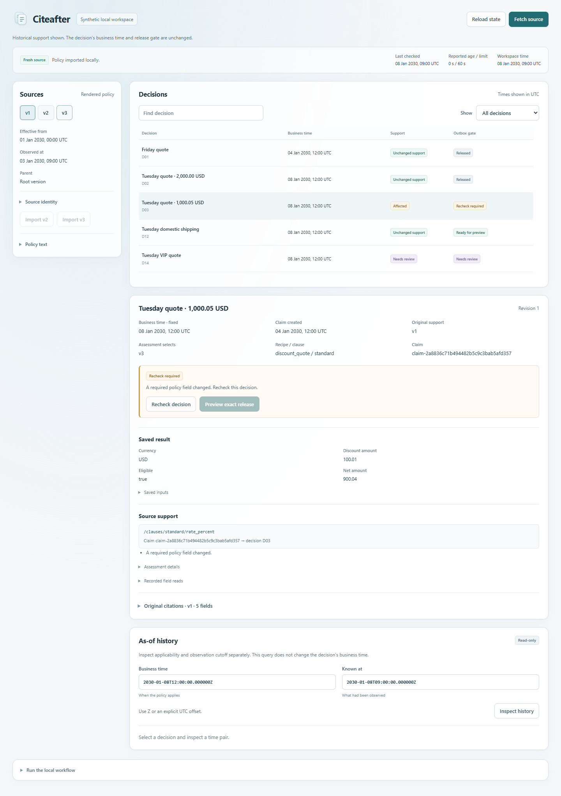

# Citeafter

Versioned evidence impact analysis for saved policy decisions and pending actions. A changed field links to the claims that read it and the drafts that need another check. Business time and knowledge time are separate.



## Run locally

Python 3.11 or newer; no runtime dependencies or paid credentials.

```sh
git clone https://github.com/bglglzd/citeafter.git
cd citeafter
python -m venv .venv
# Linux/macOS: .venv/bin/python; Windows: .venv/Scripts/python.exe
.venv/bin/python -m pip install .
.venv/bin/citeafter demo --serve
```

On Windows, use `.venv\Scripts\python.exe -m pip install .` and `.venv\Scripts\citeafter.exe demo --serve`. Open the printed `http://127.0.0.1:PORT/` address. Stop with Ctrl+C. The demo persists in `.citeafter/demo.sqlite`; rerunning resumes it. Choose a new path with `citeafter --db another-demo.sqlite demo --serve` for a fresh example. No existing ledger is deleted.

Observe v2: two Tuesday discount drafts become stale; Friday's released record and domestic shipping retain their support. Inspect a changed field and its exact citation. Recheck D02, review its preview, then release it to the **local SQLite outbox**. Observe v3: the title correction leaves unrechecked D03 stale. History queries cannot authorize a release.

The demo uses synthetic policies and an explicit fixture clock. The [recorded example](https://bglglzd.github.io/citeafter/) inspects saved engine outputs; mutations run locally through the same Python engine. The [release](https://github.com/bglglzd/citeafter/releases/tag/v0.1.0) includes a wheel, source package and recorded-demo ZIP.

## Use your own structured policy

```sh
citeafter --db work.sqlite init
citeafter --db work.sqlite import citeafter/examples/policies/v1.json
citeafter --db work.sqlite create examples/discount-action.json
citeafter --db work.sqlite state
citeafter --db work.sqlite preview quote-001
```

Inspect the returned payload before `citeafter --db work.sqlite release PREVIEW_ID`. Reimport the original file to record a fresh operator check if the 60-second freshness window has expired. For a pinned publisher, initialize a new ledger with `init --source-url https://your-host/policy.json`, then use `refresh`. [HTTP requirements and recovery](docs/operations.md) describe the supported response profile.

Only `discount_quote` and `shipping_days` have supported executable semantics. Manual claims, changed normative wording, unsupported currency/destination and ambiguous lineage require review. The input is a closed JSON schema; arbitrary PDFs, laws and free-form prose are outside this version. No language model is used.

## What is retained

- Original source bytes, first observation, explicit parent/effective date and rendered-policy UTF-8 byte citations.
- Immutable claim/action revisions and support assessments. Equivalent new support retains the old original citation.
- Generation-bound previews and one idempotent outbox receipt per action, checked inside a SQLite write transaction.

The outbox is local authorization; it does not send customer emails, payments or external transactions. Checksums detect persisted corruption; they do not authenticate an untrusted publisher or an attacker who controls the database.

[Specification](docs/spec.md) · [Architecture](docs/architecture.md) · [Operations](docs/operations.md) · [Evaluation and original disagreements](docs/evaluation.md) · [Related tools](docs/comparison.md) · [Contributing](CONTRIBUTING.md) · [MIT license](LICENSE)
