# Architecture

One Python engine serves CLI, the loopback application and recorded demonstrations. Python's standard library supplies JSON, Decimal, SQLite and HTTP transport; the UI is buildless HTML, CSS and JavaScript. The browser displays engine results and submits explicit actions.

```mermaid
flowchart LR
  P[Policy bytes + observation] --> S[Immutable sources + rendered citations]
  S --> T[Business / knowledge selection]
  T --> C[Claim reads + original support]
  C --> I[Field → claim → pending action]
  I --> R[Recheck: new revision]
  R --> V[Exact preview]
  V --> G[Transaction: current support + freshness]
  G --> O[Unique local outbox receipt]
```

## Selection and support

A source is eligible when `observed_at <= known_at` and `effective_from <= valid_at`. Explicit ancestry selects the unique eligible descendant. Equal-effective corrections need a parent link. Incomparable forks, conflicting identities, missing known parents and cycles remain unresolved. A later observation is not itself precedence. A backdated descendant is permitted when its ancestry is known.

`policy.py` validates one closed full-snapshot format and renders sorted pointer/value lines. Citations bind the original JSON SHA256, renderer ID, rendered SHA256 and exact UTF-8 byte range. They quote the labelled rendering, not an arbitrary PDF or the original JSON's formatting. Decoded JSON Pointer tokens prevent `/clause/a` from accidentally matching `/clause/ab`.

`recipes.py` records every policy read for the supported discount/shipping recipes, including kind and normative wording. Manual claims also record their own clause's kind and wording; a declared ancestor already covers its children. These reads provide citations and changed-field reverse edges while manual coverage remains unproven. Dependency inspection performs no discount arithmetic. Decimal inputs use up to two places; eligibility includes the minimum, the discount rounds once with `ROUND_HALF_UP`, and net amount subtracts that rounded value. Different currency/destination and nonempty normative text require review.

Assessments compare each saved claim with the source selected for its immutable action business date. They separate support impact, a newly evaluated result, and permission to release. A presentation-only v3 cannot clear a v1 claim still stale after a v2 rate change. An unchanged claim can receive an equivalence assessment without new recipe execution or moving its original citations.

## Ledger and release

`store.py` opens a short explicit transaction per method. Existing databases must match the application ID, schema, integrity and foreign-key checks before mutation. Source/claim/action/assessment/check/preview/outbox records are append-only; source/render and JSON checksums are checked on read. Local database control remains a trusted boundary, not an authenticated audit service.

Transactions verify retained ledger rows, and source observations append assessments. Cost grows with stored history; measurements cover small synthetic ledgers, not a large installation or long-running service.

`engine.py` stores a preview for a specific claim, assessment, source-check generation and payload. Final release takes `BEGIN IMMEDIATE`, checks current generation/revision, expiry, current selection, support and exact payload, and inserts a uniquely bound outbox row. A competing importer or rechecker cannot silently reuse an old preview. Repeated release returns the original receipt, including after source failure. This is SQLite-local atomicity.

Freshness is distinct from semantic impact. Failed or expired checks block new release while retaining historical sources and original receipts. A checked version covers itself and its explicit ancestors; checking an old ancestor cannot freshen a selected newer descendant. HTTP304 can refresh only the precise cached representation used for its conditional request. Observation is the engine's clock; identical received bytes never rewrite first observation. Operational clock rollback blocks new writes while read-only as-of queries remain available.

## Boundaries

The UI server binds only numeric loopback. Exact Host/Origin checks, an in-memory request token, closed JSON requests and a restrictive content policy protect its mutation surface. It has no remote hosting, account, collaboration or multi-tenant claim. Keep the ledger private. The static Pages view contains synthetic recorded results; it performs no engine calculations or releases.

Sources: [Python SQLite transaction behavior](https://docs.python.org/3.11/library/sqlite3.html#transaction-control), [SQLite write transactions](https://www.sqlite.org/lang_transaction.html), [Python local HTTP server](https://docs.python.org/3.11/library/http.server.html).
